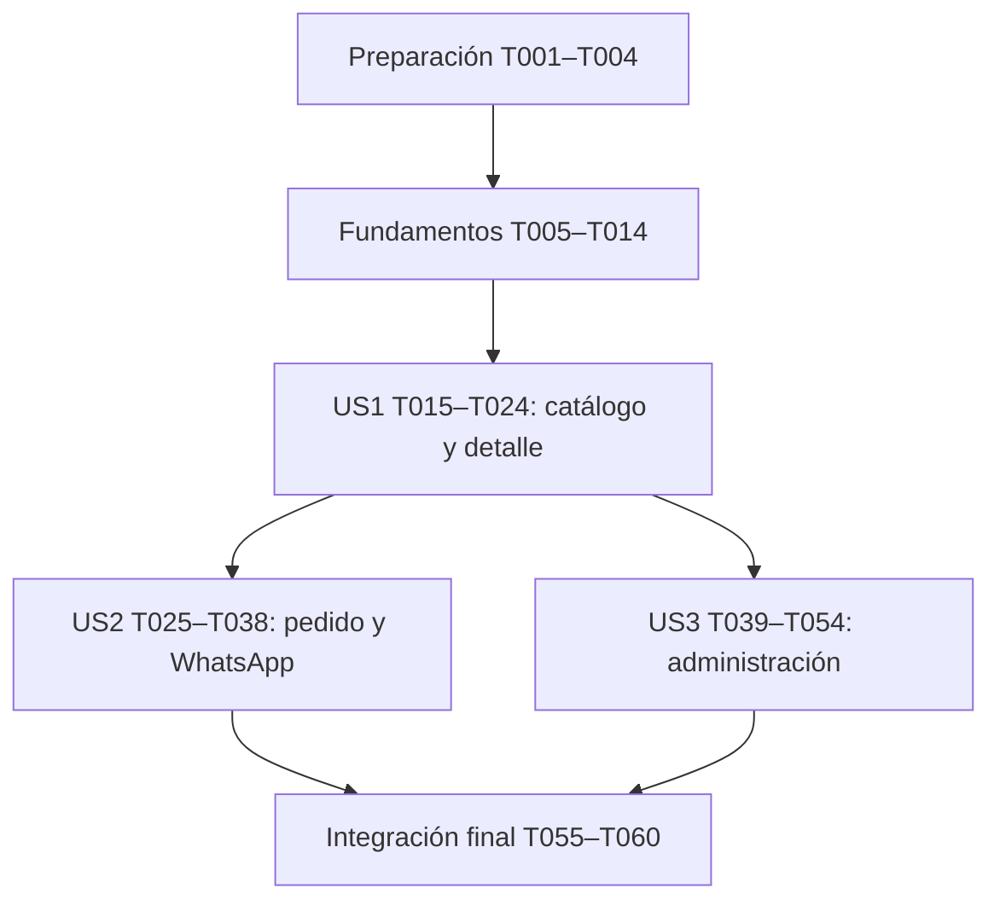

# Tasks: Chaska Store — catálogo y pedidos por WhatsApp

**Input**: [plan](plan.md), [spec](spec.md), [research](research.md), [modelo](data-model.md), [contratos](contracts/) y [quickstart](quickstart.md).

**Prerequisites**: Diseño completado, aclaración de cookie de sesión aceptada, constitución 1.0.0. La aplicación aún no está implementada.

**Tests**: Obligatorios por la constitución y AGENTS.md. Antes de implementar cada regla, escribir su prueba y ejecutarla con un fallo de comportamiento comprobado; después implementar lo mínimo y repetir hasta verde. Un fallo de importación, configuración o dependencias no demuestra la regla. Se permiten esqueletos mínimos para que las pruebas lleguen a las aserciones, sin anticipar la lógica. Registrar evidencia sin claves, tokens ni datos personales en `specs/001-chaska-catalogo-whatsapp/validation.md`.

**Organization**: Preparación → infraestructura compartida → US1 (P1) → US2 (P1) → US3 (P2) → validación transversal. Los números US coinciden con la spec. No agregar funciones fuera de FR-001–FR-024.

## Format: `[ID] [P?] [Story] Description`

Cada casilla representa trabajo pendiente. `[P]` permite ejecutar la tarea junto con las otras de su grupo una vez completadas sus dependencias; no autoriza ignorar el orden rojo/verde. Las rutas de implementación son relativas a la raíz del repositorio. Solo las fases de historias llevan `[US1]`, `[US2]` o `[US3]`.

## Phase 1: Setup — preparación compartida

**Objetivo**: Dejar un paquete JavaScript ejecutable desde la raíz, sin implementar todavía reglas de producto.

- [X] T001 Crear `package.json` y `package-lock.json` con JavaScript ESM, engines Node >=22.13.0 y las dependencias del plan: React 19/React DOM coincidentes, React Router, Vite 8/plugin-react 6, Tailwind 4/plugin Vite, Express 5, Zod 4, Multer 2, Sharp, Vitest 4.1.12, supertest 7, React Testing Library y jsdom; instalar versiones estables compatibles, congelarlas y definir scripts `dev`, `test` no interactivo, `build` y `start` sin añadir herramientas ajenas al alcance.
- [X] T002 Configurar `vite.config.js`, `client/index.html`, `client/src/main.jsx` y `client/src/styles.css` para React/Tailwind, alias compartidos si son necesarios, salida `dist/client` y proxy `/api` hacia puerto 3000; dejar un arranque mínimo y `dev` con ambos procesos, sin lógica de catálogo o administración.
- [X] T003 [P] Configurar `vitest.config.js`, `tests/setup.js`, `tests/fixtures/products.js` y `tests/fixtures/photos.js` con entornos node/jsdom separados, limpieza de pruebas, bases temporales y seis artículos de las tres categorías, incluidos precios 429900 y 32900 céntimos; incluir fotos reales JPG/PNG/WebP y archivos negativos reproducibles sin tocar datos reales.
- [X] T004 [P] Crear `.gitignore` y `.env.example` con `ADMIN_PASSWORD`, `WHATSAPP_NUMBER`, `DATABASE_PATH`, `PORT`, `APP_ORIGIN` y `NODE_ENV` según quickstart, valores ficticios y exclusión de `.env`, `data/`, `dist/` y `node_modules/`; comprobar que ningún ejemplo permite usar por defecto una clave administrativa en producción.

**Checkpoint**: Dependencias y herramientas preparadas; T003 y T004 pueden ejecutarse juntas después de T002.

## Phase 2: Foundational — prerrequisitos bloqueantes

**Objetivo**: Configuración, dinero, esquema SQLite y esqueletos de servidor/cliente comunes. Autenticación funcional pertenece a US3, no bloquea el catálogo público.

- [X] T005 Escribir y ejecutar en rojo `tests/unit/config.test.js` para clave obligatoria, configuración de origen/puerto/ruta y WhatsApp ausente o inválido sin impedir explorar; comprobar que no se exponen secretos al cliente ni se imprimen credenciales al fallar.
- [X] T006 Implementar `server/config.js` para pasar T005 con lectura de entorno y valores del quickstart, error de inicio si falta clave y estado de WhatsApp indisponible si falta número internacional solo con dígitos; permitir inyectar configuración ficticia en pruebas.
- [X] T007 Escribir y ejecutar en rojo `tests/unit/money.test.js` y `tests/unit/validation.test.js` para soles con dos decimales, conversión exacta por partes con punto/coma sin miles, enteros seguros, categorías fijas y rechazo de precio cero/negativo/exponencial/NaN/infinito o con más de dos decimales; cubrir overflow de subtotal y suma.
- [X] T008 Implementar `shared/money.js` y la base de `shared/validation.js` para pasar T007: precio “Mayor que cero y entero seguro en JavaScript”; categoría “Solo Celulares, Laptops o Accesorios; validar también en la base”; formateador único `S/` con dos decimales y aritmética en céntimos sin redondear cantidades.
- [X] T009 Escribir y ejecutar en rojo `tests/integration/db.test.js` para base nueva vacía, restricciones de producto, foto junto a campos, identidad no reutilizable, esquema de sesiones, rollback y reapertura del mismo archivo; usar directorios temporales y cerrar conexiones.
- [X] T010 Implementar `server/db.js` con `DatabaseSync` y API disponible en Node 22.13, inicialización idempotente y consultas parametrizadas: `products` con UUID TEXT “Generado por servidor, inmutable y nunca reutilizado”, campos obligatorios, precio INTEGER positivo y foto BLOB; `createdAt` de producto “Generada por servidor, usada para orden estable. No editable desde la interfaz”; `admin_sessions` con `tokenHash` TEXT primario y `createdAt` “Solo dato técnico de creación; no provoca vencimiento”; sin tabla de pedidos/clientes ni TTL, pasando T009.
- [X] T011 Escribir y ejecutar en rojo `tests/integration/app.test.js` para JSON de error en español sin trazas/secretos, JSON mal formado `400`, ruta `/api` inexistente `404` JSON y fallos de almacenamiento `503`; incluir JSON de 65 536 bytes aceptado por el parser y 65 537 rechazado con `413 REQUEST_TOO_LARGE`, lectura de flujo sin Content-Length y rechazo `415 UNSUPPORTED_ENCODING` si el cuerpo está comprimido; verificar inyección de configuración/base sin abrir puerto.
- [X] T012 Implementar `server/app.js` y `server/index.js` con fábrica de aplicación inyectable, inicio/cierre de proceso, límite inclusivo de JSON de 65 536 bytes UTF-8 medido en el flujo y sin compresión (solo Content-Encoding ausente o identity), errores comunes y base durable configurada para pasar T011; reservar montaje de rutas de historias y fallback de SPA después de `/api`.
- [X] T013 Escribir y ejecutar en rojo `tests/client/shell.test.jsx` para navegación Catálogo/Mi pedido, acceso Administración con texto, nombres accesibles, foco visible, mensajes de estado y tratamiento del error JSON en el cliente, sin crear cuentas ni pantallas adicionales.
- [X] T014 Implementar `client/src/App.jsx`, `client/src/api.js` y `client/src/components/AppShell.jsx` con React Router, cliente HTTP del mismo origen, estados accesibles y navegación compartida; reservar las seis rutas del contrato UI para implementar en cada historia y pasar T013.

**Checkpoint**: T005–T014 completadas y pruebas verdes antes de historias. Cada par de prueba/implementación se ejecuta secuencialmente; no implementar la regla antes de observar el fallo de su prueba.

## Phase 3: User Story 1 — explorar catálogo y detalle (Priority: P1) — MVP de catálogo

**Objetivo**: Ver artículos sin registro, buscar, filtrar y consultar toda su información con la composición validada.

**Prueba independiente**: Inyectar los seis productos temporales de T003, consultar las tres categorías, combinar búsqueda parcial sin distinguir mayúsculas y abrir un detalle en menos de un minuto; comprobar vacío y no disponible sin necesitar el panel de US3. La aceptación completa de US1 es solo de consulta; presencia y funcionamiento de agregar se aceptan íntegramente en US2 según FR-005, sin afirmar un agregado inexistente en la demostración de consulta.

### Tests for User Story 1 — primero en rojo

- [X] T015 [P] [US1] Escribir y ejecutar en rojo `tests/integration/catalog.test.js` para `GET /api/products`, `GET /api/products/:id` y `GET /api/products/:id/photo`: lista resumida sin BLOB, orden reciente con desempate por id, detalle completo, imagen con MIME conocido, no-store en metadatos, lista vacía y `404` para retirado/inexistente; basarse en `contracts/catalog-order.md`.
- [X] T016 [P] [US1] Escribir y ejecutar en rojo `tests/client/catalog.test.jsx` y `tests/client/product-detail.test.jsx` para filtros combinados, limpiar búsqueda conservando categoría, Todos, volver conservando filtros, descripción/especificaciones completas, foto de reemplazo, carga/error/reintento y vacío distinto de fallo; cubrir nombre Chaska Store y precios en soles.

### Implementation for User Story 1

- [X] T017 [US1] Implementar lecturas de producto en `server/products.js` y montar GET de lista/detalle en `server/app.js`, con resúmenes y DTO del contrato, orden estable, consultas sin BLOB en listado, `photoUrl` del mismo origen y UUID sin sustitución por nombre; pasar la parte de metadatos de T015.
- [X] T018 [US1] Implementar servicio público de foto en `server/photos.js` y montaje en `server/app.js` desde el BLOB ya normalizado, `image/webp`, ETag/revalidación y `404` si el producto no existe; pasar la parte de imagen de T015 sin subir archivos todavía.
- [X] T019 [US1] Implementar filtrado de nombre mediante `toLocaleLowerCase('es-PE')` y coincidencia parcial, combinación con categoría y estado de retorno en `client/src/pages/catalog-state.js`; Todos no se almacena como categoría y borrar búsqueda no limpia el filtro.
- [X] T020 [US1] Implementar `client/src/components/ProductCard.jsx` y `client/src/pages/CatalogPage.jsx` con foto, nombre, precio, búsqueda, cuatro filtros, carga/vacío/error y reintento; no introducir ordenamiento seleccionable, promociones ni productos de ejemplo permanentes.
- [X] T021 [US1] Implementar `client/src/pages/ProductDetailPage.jsx` con foto ampliada, categoría, nombre, precio, descripción y especificaciones multilínea legibles, volver y estado no disponible; no truncar permanentemente texto ni deducir fichas técnicas propias de celulares.
- [X] T022 [US1] Integrar catálogo y detalle en `client/src/App.jsx` y `client/src/components/AppShell.jsx`, conservando filtros al volver, enlaces por UUID y acceso público sin clave; dejar el punto de integración de agregar para US2 y pasar T016.
- [X] T023 [US1] Ajustar `client/src/styles.css` y las clases de `client/src/pages/CatalogPage.jsx` y `client/src/pages/ProductDetailPage.jsx` contra `docs/diseno/01-catalogo-movil.png` y `docs/diseno/02-detalle-producto-movil.png`: tema oscuro, tarjetas redondeadas, dos columnas cuando quepan, navegación inferior y espacio para acciones sin tapar contenido.
- [X] T024 [US1] Ejecutar pruebas de catálogo/detalle y la demostración independiente con fixtures; registrar comandos, resultados SC-001 y comprobación inicial 360/390/1440 px en `specs/001-chaska-catalogo-whatsapp/validation.md`, distinguiendo este MVP parcial de la feature terminada.

**Checkpoint**: Consulta pública demostrable y pruebas de US1 verdes. Catálogo real nuevo puede estar vacío; no precargar inventario sin solicitud.

## Phase 4: User Story 2 — preparar pedido y abrir WhatsApp (Priority: P1)

**Objetivo**: Agregar desde catálogo/detalle, ajustar cantidades, conservar el pedido y abrir un resumen verificado con el número configurado.

**Prueba independiente**: Con fixtures o artículos disponibles, pedir una unidad de 429900 y dos de 32900 céntimos: dos líneas, contador 3 y total `S/ 4957.00`; preparar mensaje en menos de dos minutos, volver y conservar selección. Retirar un fixture directamente en la base temporal permite probar indisponibilidad sin depender de US3.

### Tests for User Story 2 — primero en rojo

- [X] T025 [P] [US2] Escribir y ejecutar en rojo `tests/unit/order.test.js` para una línea por identidad, agregado repetido, cantidad entera segura positiva, mínimo 1 sin borrado implícito, quitar, total/contador derivados y overflow; cubrir producto retirado identificado por UUID sin reemplazo por nombre.
- [X] T026 [P] [US2] Escribir y ejecutar en rojo `tests/unit/order-storage.test.js` para clave `chaska.order.v1`, restauración tras recarga, estructura corrupta, versión ajena y almacenamiento bloqueado; preservar copia de presentación y prohibir credenciales/datos personales en el pedido.
- [X] T027 [P] [US2] Escribir y ejecutar en rojo `tests/integration/order-preview.test.js` para POST de resumen: precios del servidor, ejemplo `S/ 4957.00`, UUID repetidos/inválidos, vacío, cantidad inválida/overflow, mensaje/URL codificados, producto retirado `409` sin URL, fallo de base y WhatsApp sin configurar `503`, sin filas de pedidos creadas; cubrir también petición JSON excesiva `413 REQUEST_TOO_LARGE` sin URL ni truncamiento.
- [X] T028 [P] [US2] Escribir y ejecutar en rojo `tests/client/order-flow.test.jsx` para agregar desde ambas pantallas con aviso sin abandonarlas, contador de unidades, ajustes/quitar/vacío, barras accesibles, bloqueo durante envío, nueva pulsación tras retiradas, error de red o `413` conservando pedido, sin recorte ni apertura de WhatsApp, y navegación en misma pestaña sin afirmar envío confirmado.

### Implementation for User Story 2

- [X] T029 [US2] Implementar `client/src/order/reducer.js` para pasar T025: `productId` como “Relación lógica con producto; puede quedar obsoleta tras retirarlo”; `quantity` “Mayor o igual a 1; agregar repetido incrementa; restar en 1 conserva 1”; identidad única por línea, quitar explícito y subtotales/total/contador derivados con enteros seguros.
- [X] T030 [US2] Implementar `client/src/order/storage.js` para pasar T026: `version` “1; permite detectar estructuras no compatibles”; `items` “Vacía o una línea por identidad de producto”; copias `name`, `photoUrl`, `priceCents` que “No son autoridad para preparar el mensaje; permiten mostrar y nombrar una línea retirada”; fallo detectable conserva memoria y avisa que la recarga puede perderla.
- [X] T031 [US2] Extender `shared/validation.js` con esquema de resumen de `contracts/catalog-order.md`: lista no vacía, UUID únicos, cantidades enteras positivas seguras y rechazo de entradas inválidas sin coerción silenciosa; pasar validaciones de T027.
- [X] T032 [US2] Implementar `server/order-preview.js` y montar POST en `server/app.js`: lectura consistente de productos, cálculo en céntimos, mensaje de todas las líneas y `https://wa.me/` con texto codificado, `409` con ids retirados/líneas válidas/total sin URL y `503` si WhatsApp no está configurado; pasar T027 sin persistir ventas, datos personales ni confirmaciones de envío.
- [X] T033 [US2] Crear `client/src/order/OrderProvider.jsx` e integrarlo en `client/src/App.jsx` con restauración validada, guardado de cambios, API de agregar/ajustar/quitar y avisos accesibles; no usar almacenamiento del pedido para autenticar al administrador.
- [X] T034 [US2] Conectar acciones reales de agregar y contador en `client/src/components/ProductCard.jsx`, `client/src/pages/ProductDetailPage.jsx` y `client/src/components/AppShell.jsx`; confirmar visualmente cada agregado sin navegación ni duplicar líneas, pasando los casos correspondientes de T028.
- [X] T035 [US2] Implementar `client/src/pages/OrderPage.jsx` y su ruta con foto/nombre/unitario/cantidad/subtotal, menos deshabilitado en 1, más, quitar y total; mostrar vacío con enlace al catálogo y no permitir envío vacío, conforme a `docs/diseno/03-mi-pedido-movil.png`.
- [X] T036 [US2] Implementar en `client/src/pages/OrderPage.jsx` la preparación asíncrona y apertura con `window.location.assign`, guardando antes la selección, deshabilitando mientras carga y mostrando el aviso de ausencia de pago; no abrir ventanas emergentes ni borrar el pedido al volver desde WhatsApp.
- [X] T037 [US2] Completar en `client/src/pages/OrderPage.jsx` el tratamiento de `409` nombrando retiradas con copias locales, eliminando solo esas líneas, recalculando y exigiendo nueva pulsación; en errores de red/almacenamiento/número conservar el pedido y ofrecer reintento sin afirmar envío; pasar T028.
- [X] T038 [US2] Ejecutar pruebas de US2 y repetir SC-002/SC-006 y los casos de recarga, retirada y retorno de WhatsApp; registrar resultados y evidencia rojo/verde en `specs/001-chaska-catalogo-whatsapp/validation.md` sin enviar mensajes reales como parte de la automatización.

**Checkpoint**: Recorrido de compra completo con fixtures o productos publicados, sin pagos ni registro y sin depender de la administración para probarlo.

## Phase 5: User Story 3 — administrar productos con acceso privado (Priority: P2)

**Objetivo**: Autenticar, agregar un producto con foto, confirmar o cancelar su retirada y revocar acceso al salir.

**Prueba independiente**: Partir de una base temporal o vacía, ingresar, agregar un accesorio, consultarlo públicamente, cancelar su retirada y después confirmarla; reiniciar conserva cambios. Logout invalida incluso una copia de la cookie anterior. No requiere armar un pedido de US2 para demostrar administración.

### Tests for User Story 3 — primero en rojo

- [X] T039 [P] [US3] Escribir y ejecutar en rojo `tests/integration/admin-session.test.js` para clave correcta/vacía/incorrecta, acceso privado sin sesión, token nuevo, atributos HttpOnly/SameSite/Secure por entorno y ausencia de Expires/Max-Age, persistencia tras reinicio y avance de reloj, logout idempotente y reproducción de cookie revocada; probar Origin ajeno/ausente `403` en mutaciones según `contracts/admin.md`.
- [X] T040 [P] [US3] Escribir y ejecutar en rojo `tests/unit/photos.test.js` para JPG/PNG/WebP reales, decodificación completa, corrupción, MIME falso, SVG/GIF, normalización a WebP hasta 1600 px sin ampliar/metadatos y límite de 5 000 000 bytes exacto/un byte superior; usar fixtures reproducibles de `tests/fixtures/photos.js`.
- [X] T041 [P] [US3] Escribir y ejecutar en rojo `tests/integration/admin-products.test.js` para listado privado, alta multipart completa, restricciones de campos/precio/categoría, nombre de 200/201 caracteres Unicode, descripción y especificaciones de 5000/5001 cada una después de trim, conteo multibyte y límites válidos simultáneos, campos de 20 000/20 001 bytes UTF-8 y cuerpo multipart de 5 100 000/5 100 001 bytes incluidos flujos sin Content-Length (aislar cada frontera, con `400 VALIDATION_ERROR` por caracteres, `413 FIELD_TOO_LARGE` por bytes del campo y `413 REQUEST_TOO_LARGE` por cuerpo), dos fotos o campos repetidos/ajenos, autorización antes de procesar foto, fallo sin producto parcial, retiro repetido `204`, producto/foto inexistentes tras borrar, alta con nombre igual y UUID distinto, y persistencia al reiniciar.
- [X] T042 [P] [US3] Escribir y ejecutar en rojo `tests/client/admin.test.jsx` para acceso con error, panel vacío/tabla, formulario con máximos visibles de 200/5000/5000 caracteres Unicode después de trim y errores por exceso que conservan textos, respuesta `413` con mensaje y sin éxito falso, cancelar sin publicar, bloqueo de doble guardado, confirmación nombrada y cancelación de quitar, logout/retroceso y ocultación de datos privados tras `401`; comprobar etiquetas/foco y ausencia de controles de edición ajenos a la spec.

### Implementation for User Story 3

- [X] T043 [US3] Implementar `server/auth.js` con token aleatorio de 32 bytes y `tokenHash` “Hash de un token criptográficamente aleatorio de 32 bytes; el token sin hash solo viaja en cookie HttpOnly”; clave de entorno comparada mediante hashes de longitud fija en tiempo constante, sesión persistente sin TTL, rotación al login y revocación de fila al logout; nunca registrar ni persistir la clave o token en claro y pasar la lógica de T039.
- [X] T044 [US3] Montar POST/GET/DELETE de `/api/admin/session`, autorización por petición y comprobación exacta de `APP_ORIGIN` en `server/app.js` y `server/auth.js`; configurar cookie `chaska_admin` con `Path=/`, HttpOnly, SameSite=Strict, Secure en producción, sin vencimiento al crearla y borrado al salir, respuestas privadas no-store y errores del contrato; pasar T039; mantener la reproducción de cookie revocada como prueba técnica de FR-020, separada de la aceptación visible SC-005, sin logout en eventos de cierre del navegador.
- [X] T045 [US3] Extender `server/photos.js` con recepción de un archivo y normalización de “Una imagen normalizada WebP, después de decodificar un archivo JPG, PNG o WebP válido de hasta 5 000 000 bytes”; verificar formato real, decodificar antes de guardar, orientar, reducir hasta 1600 px sin ampliar y retirar metadatos, pasando T040; recepción acotada a cinco campos, un archivo, seis partes, nombres de campo de hasta 32 bytes UTF-8, campo de hasta 20 000 bytes UTF-8 y cuerpo multipart de hasta 5 100 000 bytes reales incluidos delimitadores/cabeceras, con errores exactos de `contracts/admin.md`; no introducir un nuevo máximo comercial de píxeles.
- [X] T046 [US3] Extender `shared/validation.js` con alta: nombre “Obligatorio; recortar extremos; no aceptar solo espacios; máximo inclusivo de 200 caracteres Unicode (puntos de código), sin truncar. No es único: productos con nombres iguales siguen siendo artículos distintos”; descripción “Obligatorio y no compuesto solo por espacios; conservar párrafos; máximo inclusivo de 5000 caracteres Unicode después de trim, sin truncar”; especificaciones “Obligatorio y no compuesto solo por espacios; conservar saltos de línea; máximo inclusivo de 5000 caracteres Unicode después de trim, sin truncar”; reutilizar precio/categoría de T008 y exigir todos los campos y una foto, aplicar máximos inclusivos de 200 caracteres Unicode para nombre y 5000 para descripción/especificaciones después de trim, contando puntos de código y sin truncar; exceso `400 VALIDATION_ERROR` por campo y fronteras de T041.
- [X] T047 [US3] Extender `server/products.js` y `server/app.js` con listado privado, alta multipart después de autenticar/comprobar origen, INSERT único de datos/foto y DELETE conjunto idempotente; generar UUID nuevo y createdAt UTC del servidor, rechazar campos repetidos/ajenos y mapear errores de campo y los límites 20 000 bytes por campo, 5 000 000 bytes por foto y 5 100 000 bytes por cuerpo (primer límite detectado, sin depender solo de Content-Length), además de almacenamiento conforme al contrato, pasando T041 sin archivos huérfanos.
- [X] T048 [US3] Crear `client/src/components/AdminGuard.jsx` y `client/src/pages/AdminLoginPage.jsx` con consulta de sesión al entrar, clave oculta, error accesible, redirección tras autenticación y autorización siempre consultada al servidor; ocultar datos ante `401` y no guardar la clave ni el token en localStorage/sessionStorage.
- [X] T049 [US3] Implementar `client/src/pages/AdminPanelPage.jsx` con tabla Foto/Nombre/Categoría/Precio/Acción, agregar, estado vacío y confirmación accesible con nombre del producto, cancelar sin DELETE y retirada visible solo al confirmar servidor; logout llama al servidor y vuelve al acceso, pasando los casos de panel de T042.
- [X] T050 [US3] Implementar `client/src/pages/AddProductPage.jsx` con nombre/categoría/precio/descripción/especificaciones/foto, selección de archivo, cancelar, validación y errores por campo, envío multipart y botón deshabilitado durante subida; mostrar los máximos 200/5000/5000, validar puntos de código tras trim sin truncar y conservar textos válidos al fallar, incluidos `400` por campo y `413` de tamaño y pedir reselección de foto si hace falta, sin reintento automático de un alta cuyo resultado de red es incierto.
- [X] T051 [US3] Integrar las tres rutas privadas y estilos en `client/src/App.jsx` y `client/src/styles.css`, siguiendo `docs/diseno/04-acceso-administrador-escritorio.png`, `docs/diseno/05-panel-administracion-escritorio.png` y `docs/diseno/06-agregar-producto-escritorio.png`; acceso centrado con campos de la spec pese al recorte de 04, tabla sin barra lateral y formulario amplio a 1440 px.
- [X] T052 [US3] Completar en `client/src/components/AdminGuard.jsx`, `client/src/pages/AdminPanelPage.jsx` y `client/src/pages/AddProductPage.jsx` reintentos, carga/error distintos de vacío, preservación de fila ante fallo de retirada, retorno de foco al cancelar y navegación atrás tras logout; ejecutar T042 hasta verde, sin afirmar éxito con respuesta fallida.
- [X] T053 [US3] Ejecutar T039–T042 y la reapertura del archivo en `tests/integration/admin-products.test.js` y `tests/integration/admin-session.test.js`; comprobar consulta pública tras alta/retirada y rechazo de cookie antigua tras logout como prueba técnica del contrato/FR-020, no como acción de aceptación de SC-005, registrando evidencia en `specs/001-chaska-catalogo-whatsapp/validation.md`.
- [X] T054 [US3] Validar SC-003/SC-005 desde las pantallas a 1440 px, sin herramientas de desarrollador: clave incorrecta, panel sin ingreso, logout y retorno mediante atrás/otra pestaña requieren clave; comprobar por separado la sesión real con restauración de navegador activada/desactivada; registrar navegador/configuración, tiempos y resultados en `specs/001-chaska-catalogo-whatsapp/validation.md`, aceptando posible restauración de cookie y exigiendo revocación fiable mediante “Cerrar sesión”.

**Checkpoint**: Administración demostrable, productos/fotos y sesiones persistentes, retirada reflejada en catálogo y logout revocable en servidor. La restauración de navegador no se confunde con una garantía de cierre universal.

## Phase 6: Polish & Cross-Cutting Concerns

**Objetivo**: Verificar integración, producción y criterios completos sin añadir funciones nuevas ni refactorizaciones ajenas al alcance.

- [X] T055 Escribir y ejecutar en rojo `tests/integration/production.test.js` para cliente compilado servido por Express, enlaces directos de las seis rutas con fallback SPA después de `/api`, `/api` desconocido conservando `404` JSON, cookies Secure en producción y persistencia tras reinicio; no confundir disponibilidad del HTML con autorización de la API.
- [ ] T056 Completar el servicio de `dist/client` y fallback de producción en `server/app.js`, arranque de `server/index.js` y scripts de `package.json` para pasar T055; comprobar `npm run build` seguido de `npm start` con origen HTTPS configurado y la misma base durable, sin introducir despliegue/pública publicación automática.
- [X] T057 Revisar las seis imágenes y realizar teclado/foco, texto extenso, imágenes rotas, barras inferiores y ausencia de desplazamiento horizontal a los anchos de SC-004; corregir solo discrepancias de la spec en `client/src/styles.css` y componentes afectados, agregando primero regresiones de comportamiento en `tests/client/accessibility.test.jsx` cuando proceda; registrar resultados en `specs/001-chaska-catalogo-whatsapp/validation.md`.
- [X] T058 Verificar instalación reproducible y `npm test`/`npm run build` en Node 22.13.0 y el LTS escogido; corregir incompatibilidades reales en `package.json`, `package-lock.json` o archivos afectados y registrar versiones/comandos/resultados en `specs/001-chaska-catalogo-whatsapp/validation.md`, sin tomar Node 25 local como prueba del mínimo.
- [X] T059 Documentar ejecución, variables, almacenamiento durable, límites reales de sesión y procedimiento de revocación de `admin_sessions` al cambiar la clave sin borrar `products` en `README.md` y `specs/001-chaska-catalogo-whatsapp/quickstart.md`; contrastar `.env.example`, no incluir secretos y conservar la guía como instrucciones, no como implementación duplicada.
- [ ] T060 Ejecutar `npm test`, `npm run build` y los recorridos SC-001–SC-007 de `specs/001-chaska-catalogo-whatsapp/quickstart.md`; registrar resultados finales y trazabilidad rojo/verde en `specs/001-chaska-catalogo-whatsapp/validation.md`, revisar los seis principios y actualizar `specs/README.md` a implementada solo si las pruebas y criterios requeridos pasan, reportando cualquier limitación pendiente.

## Dependencies & Execution Order

### Dependencias por fase

Orden recomendado de implementación individual: T001 → T060. US1 y US2 comparten prioridad P1; se hace catálogo primero porque el flujo de agregado depende de sus pantallas. US3 usa el esquema y las lecturas públicas de US1, pero sus pruebas no requieren el pedido de US2. US2 prueba retiradas modificando fixtures/base temporal, sin esperar US3.

Dentro de US1, T015/T016 se ejecutan después de fundamentos; T017/T018 preceden la conexión de páginas. Dentro de US2, T025–T028 forman el grupo de pruebas; T029/T030 preceden T033, T031 precede T032 y T033/T034 preceden T035–T037. Dentro de US3, T039–T042 preceden la lógica; T043 precede T044, T045/T046 preceden T047 y las API de T044/T047 preceden la integración final T051–T054. Todos los checkpoints exigen pasar las pruebas del incremento.

### Oportunidades paralelas

Hay **12 tareas marcadas [P]**, repartidas en cuatro grupos: T003/T004; T015/T016; T025–T028; T039–T042. Cada grupo trabaja en archivos distintos y solo comienza después de resolver sus prerrequisitos. Los grupos de prueba pueden escribir/ejecutar casos en paralelo; las implementaciones esperan la evidencia roja de los casos correspondientes.

US2 y US3 podrían desarrollarse sobre ramas aisladas tras US1, pero no se marcan globalmente paralelas: ambas montan rutas en `server/app.js`, comparten validación y tocan `client/src/App.jsx`. Coordinar esos archivos secuencialmente al integrar; no editar el mismo archivo a la vez. Esta sección describe posibilidades de ejecución futura y no lanza agentes.

## Parallel Example: User Story 1

Después de T014: T015 trabaja en `tests/integration/catalog.test.js` mientras T016 trabaja en `tests/client/catalog.test.jsx` y `tests/client/product-detail.test.jsx`. Integrar las pruebas, observar fallos de reglas y luego continuar con T017–T023. US1 se valida con fixtures y no espera la pantalla de alta.

## Parallel Example: User Story 2

Después de US1: T025 escribe reglas de líneas en `tests/unit/order.test.js`, T026 persistencia en `tests/unit/order-storage.test.js`, T027 contrato HTTP en `tests/integration/order-preview.test.js` y T028 interacción en `tests/client/order-flow.test.jsx`. No modificar el mismo fixture compartido durante el trabajo paralelo; si falta un caso, incorporarlo primero de forma secuencial.

## Parallel Example: User Story 3

Después de US1 y fundamentos: T039 cubre sesiones, T040 fotos, T041 mutaciones y T042 pantallas en sus cuatro archivos separados. Usar las fotos de T003 sin editarlas simultáneamente. Tras los fallos comprobados, implementar en orden T043–T052 y cerrar con T053/T054.

## Implementation Strategy

### MVP first

Preparación + fundamentos + US1 producen un MVP de consulta pública demostrable con seis fixtures temporales. Esta demostración no se presenta como tienda terminada: las acciones de pedido pertenecen a US2 y la gestión real de catálogo a US3. Para el primer flujo comercial completo agregar US2; para una versión 1 operable por el administrador completar las tres historias y la fase final.

### Entrega incremental

Implementar una regla por ciclo rojo/verde, mantener pruebas anteriores pasando y registrar checkpoints. Completar US1 antes de conectar el pedido; completar US2 y luego US3 en ejecución individual; finalmente validar el recorrido con productos creados desde el panel, sin fixtures obligatorios en producción. No publicar, hacer merge o enviar mensajes reales como consecuencia implícita de estas tareas.

### Cobertura de requisitos

| Requisito | Tareas principales |
| --- | --- |
| FR-001 | T007–T008, T016, T023, T051, T060 |
| FR-002 | T015, T017–T018, T020–T022 |
| FR-003 | T016, T019–T020 |
| FR-004 | T015–T016, T021–T023 |
| FR-005 | T025, T028–T029, T033–T034 |
| FR-006 | T025, T028–T029, T035 |
| FR-007 | T007–T008, T025, T027, T029, T032 |
| FR-008 | T026, T030, T033, T036, T038 |
| FR-009 | T025, T027–T028, T035–T036 |
| FR-010 | T027, T031–T032, T036, T038 |
| FR-011 | T028, T036, T038, T060 |
| FR-012 | T027–T028, T032, T037–T038 |
| FR-013 | T027–T028, T032–T033, T060 |
| FR-014 | T039, T043–T044, T048, T053 |
| FR-015 | T041–T042, T047, T049 |
| FR-016 | T007–T008, T040–T041, T045–T047, T050 |
| FR-017 | T041–T042, T047, T050 |
| FR-018 | T041–T042, T047, T050, T052 |
| FR-019 | T015, T041–T042, T047, T049, T052 |
| FR-020 | T039, T043–T044, T048–T049, T053–T054 |
| FR-021 | T009–T010, T041, T047, T053, T055–T056 |
| FR-022 | T011–T014, T016, T020–T021, T028, T037, T042, T052 |
| FR-023 | T023, T035, T051, T057 |
| FR-024 | T013–T014, T016, T028, T042, T052, T057 |

SC-001: T024/T060; SC-002: T038/T060; SC-003: T054/T060; SC-004: T023/T051/T057/T060; SC-005: T054/T060; SC-006: T038/T060; SC-007: T060.

## Notes

Todas las casillas se generan pendientes; redactar esta lista no ejecuta pruebas ni implementa el producto. `validation.md` es el registro de implementación previsto, no un artefacto de evidencia ya existente. El checklist de calidad de requisitos conserva su propio significado y no sustituye estas tareas. Si se descubre un requisito nuevo, proponerlo antes de incorporarlo; si falla una comprobación, corregir la causa y repetir la prueba afectada antes del cierre.

## Estado al finalizar la ejecución

58/60 tareas completadas. T056 tiene implementación y pruebas de producción aprobadas, pero su ejecución de `npm start` en producción fue rechazada por el control automático («blocked by policy»), incluso con interfaz local y base de QA. T060 no se marca como cierre completo mientras T056 siga pendiente. Evidencia, resultados de 95 tests y limitaciones: [validation.md](validation.md). No se hicieron commits.
